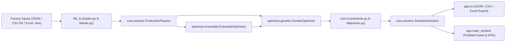

# production-planner

[](https://github.com/andrew-abdelmalak/production-planner/actions/workflows/ci.yml)
[](pyproject.toml)
[](LICENSE)

Multi-line factory production scheduling optimizer and interactive PySide6 Gantt planner powered by a genetic algorithm and multi-start ensemble search.

I started this tool during a manufacturing engineering internship to schedule bottling lines with weekday-specific shifts, clean-in-place (CIP) stops, and sequence-dependent SKU changeovers. I then generalized the file loaders and CLI so any small or mid-size factory can schedule its own lines from plain CSV folders, Excel workbooks (`.xlsx`), or JSON configs without writing code.

---

## Key Features

- **Constraint-aware genetic solver**: Enforces line compatibility, no-overlap windows, minimum batch sizes, horizon limits, shift schedules (including overnight shifts and day-of-week outages), and mandatory continuous-run cleaning breaks.
- **Timing-weighted changeover penalties**: Differentiates changeovers happening across non-working downtime windows from disruptive mid-shift setups.
- **Multi-start ensemble search and scenario presets**: Runs multiple independent GA starts (`EnsembleOptimizer`) or selects preset weight profiles (`balanced`, `heavy_week`, `light_week`, `deadline`).
- **Generic factory templates**: Loads and exports JSON files (`examples/`), CSV directories (`templates/*.csv`), and multi-sheet Excel workbooks (`templates/factory_template.xlsx`) through `file_io/tabular.py`.
- **Headless CLI and desktop Gantt UI**: Run reproducible batch solves via `production-planner` or inspect schedules interactively via `production-planner-gui`.

## Architecture



## Installation

Requires Python 3.11+ and [`uv`](https://docs.astral.sh/uv/).

```bash
git clone https://github.com/andrew-abdelmalak/production-planner.git
cd production-planner
uv sync --locked --extra gui
```

To run headless CLI workloads on servers without Qt GUI dependencies:

```bash
uv sync --locked
```

## Quick Start

### Solve a sample factory from the CLI

```bash
# Built-in bottling benchmark (3 lines, 6 SKUs, weekday + overnight shifts)
uv run production-planner -i examples/water_factory_config.json -o outputs/water.xlsx --population 30 --generations 20 --seed 42

# Editable generic Excel template (2 lines, 5 SKUs)
uv run production-planner -i templates/factory_template.xlsx -o outputs/template.xlsx --population 30 --generations 20 --seed 42

# Directory of CSV tables
uv run production-planner -i templates/ -o outputs/schedule.csv --population 30 --generations 20 --seed 42
```

### Launch the desktop Gantt planner

```bash
uv run production-planner-gui
```

On headless Linux displays, pass `QT_QPA_PLATFORM=offscreen` when running Qt smoke tests or verification scripts.

## Verified Sample Benchmarks

The numbers below come directly from seeded runs on this repository (`--population 30 --generations 20 --seed 42`):

| Dataset | Lines | SKUs | Blocks | Makespan (h) | Changeover Cost | Changeover Time (min) | Demand Fulfillment |
|---|---:|---:|---:|---:|---:|---:|---:|
| [`examples/small_factory.json`](examples/small_factory.json) | 2 | 5 | 8 | 35.00 | 500.00 | 225 | 100.0% (65,000 / 65,000 units) |
| [`examples/water_factory_config.json`](examples/water_factory_config.json) | 3 | 6 | 20 | 113.90 | 300.00 | 360 | 100.0% (2,170,000 net units produced) |
| [`templates/factory_template.xlsx`](templates/factory_template.xlsx) | 2 | 5 | 9 | 35.00 | 300.00 | 150 | 100.0% (65,000 / 65,000 units) |

Note on `examples/water_factory_config.json`: Demand fulfillment accounts for on-hand `starting_stock` before scheduling remaining production volume across Saturday-to-Thursday morning/night shifts plus Friday night-only operation (all 6 SKUs meet 100.0% target demand).

## Using Your Own Factory Data

You do not need to touch Python code or write JSON to plan your own shop floor. Copy either [`templates/factory_template.xlsx`](templates/factory_template.xlsx) or the CSV files in [`templates/`](templates/), fill in your lines, SKUs, line speeds, shifts, and changeovers, and pass the file or folder to `--input`.

Every worksheet, CSV file, column type, and default value is documented in [docs/input-format.md](docs/input-format.md).

## CLI Reference

| Flag | Default | Description |
|---|---|---|
| `-i`, `--input` | Required | Path to a JSON config, Excel workbook (`.xlsx`), or CSV folder |
| `-f`, `--format` | `auto` | Input format override (`auto`, `json`, `csv`, `xlsx`) |
| `-o`, `--output` | None | Export path (`.json`, `.csv`, or `.xlsx`) |
| `--output-format` | `auto` | Output format override (`auto`, `json`, `csv`, `xlsx`) |
| `--population` | `100` | Genetic algorithm population size |
| `--generations` | Preset or `75` | Number of GA generations |
| `--runs` | `1` | Independent GA starts (`> 1` uses `EnsembleOptimizer`) |
| `--scenario` | None | Weight preset (`balanced`, `heavy_week`, `light_week`, `deadline`) |
| `--seed` | None | Random seed for reproducible schedules |
| `--quiet` | `false` | Suppress summary table output |

### Scenario Presets

| Preset | Generations | Ensemble Runs | Makespan Weight | Changeover Weight | Demand Weight |
|---|---:|---:|---:|---:|---:|
| `balanced` | 75 | 5 | 1.0 | 1.5 | 10.0 |
| `heavy_week` | 100 | 7 | 0.5 | 0.5 | 20.0 |
| `light_week` | 50 | 3 | 1.0 | 3.0 | 5.0 |
| `deadline` | 75 | 5 | 3.0 | 0.5 | 10.0 |

## Development and Verification

Run lint checks, unit/integration tests, and packaging:

```bash
# Lint with Ruff
uv run ruff check .

# Full test suite (91 tests covering constraints, objectives, loaders, solver, CLI, and offscreen GUI)
QT_QPA_PLATFORM=offscreen uv run pytest -v

# Optional: build a standalone desktop executable (requires --extra build)
uv sync --locked --extra gui --extra build
uv run python scripts/build_exe.py
```

## Troubleshooting

| Symptom | Cause | Fix |
|---|---|---|
| `Cannot infer input format` | Unknown extension passed to `-i` | Pass `-f json`, `-f csv`, or `-f xlsx` explicitly |
| `ImportError: PySide6 is required` | Synced without GUI dependencies | Run `uv sync --locked --extra gui` |
| Qt fails on a headless server | Missing display server or X11/EGL libs | Set `QT_QPA_PLATFORM=offscreen` or use `production-planner` CLI |
| Partial demand in tight horizons | Insufficient shift hours or oversized `min_batch_size` | Extend `planning_horizon_days`, add shifts, or lower `min_batch_size` |

## Limitations and Scope

- **Stochastic heuristic solver**: The genetic algorithm searches for feasible high-quality schedules quickly without an external MILP solver, so it does not prove global mathematical optimality. Pass `--seed` for repeatable runs or `--runs` to pick the best of multiple starts.
- **Single global changeover default in Excel/CSV `Settings`**: Per-pair exceptions are preserved per line in `Changeovers` / `changeovers.csv`, while the `Settings` sheet stores one repository-wide fallback pair (`default_changeover_minutes`, `default_changeover_cost`).
- **File-based workflow**: Inputs and schedules exchange via JSON, CSV, and `.xlsx` rather than live ERP/MES database connectors.

## Project Structure

```text
app/            Desktop GUI (PySide6 Gantt, config panel, KPI panel) and CLI
core/           Domain dataclasses, hard/soft constraints, objectives, presets
optimizer/      GeneticOptimizer and multi-start EnsembleOptimizer
file_io/        JSON loader and generic CSV / Excel tabular I/O
templates/      Ready-to-edit CSV directory and multi-sheet Excel workbook
examples/       Sample factory configs (small_factory.json, water_factory_config.json)
docs/           Tabular schema documentation
scripts/        PyInstaller executable build script
tests/          91 automated tests across core, solver, file I/O, CLI, and GUI
```

## Contributing and Security

- See [CONTRIBUTING.md](CONTRIBUTING.md) for development workflow and test commands.
- See [CODE_OF_CONDUCT.md](CODE_OF_CONDUCT.md) for community expectations.
- Report security issues privately via [SECURITY.md](SECURITY.md).
- For usage questions and scope details, see [SUPPORT.md](SUPPORT.md).

## License and Citation

Licensed under the [Apache License 2.0](LICENSE). If you reference or build on this repository, see [CITATION.cff](CITATION.cff).
